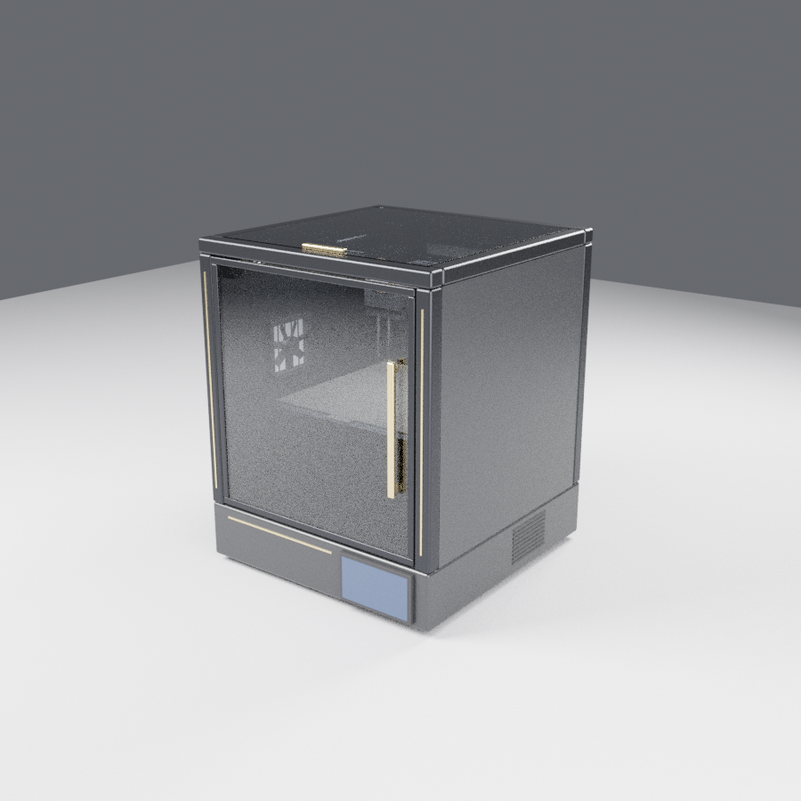

# jarvis-mundimakers-3d-assets

Pipeline de assets 3D do projeto Jarvis Mundimakers, gerados com Blender headless.

## Setup rápido (sessão nova)
```bash
bash scripts/setup.sh --with-gltf-transform   # verifica versões e só instala o que falta
```
`gltf-transform` fica em `.tools/` (local, no `.gitignore`), nunca global.

## Assets
| Asset | Arquivo | Docs |
|---|---|---|
| **Elegoo CC2 (estilo) v1** | `assets/printers/elegoo_cc2_v1.glb` (172 KB, meshopt, 24 malhas, 8 pivôs) | [`docs/elegoo-cc2-v1.md`](docs/elegoo-cc2-v1.md) |
| Impressora 3D fechada v001 (protótipo) | `assets/printer/printer_proto_v001.glb` (164 KB, 14 malhas) | [`docs/printer-prototype.md`](docs/printer-prototype.md) |
| Cubo de teste 10 cm | `assets/test/cube_10cm.glb` | abaixo |



## Estrutura
| Pasta | Conteúdo |
|---|---|
| `scripts/` | `setup.sh` e scripts Python executados pelo Blender (`--python`) |
| `scripts/printer/` | build, validação e prévia da impressora |
| `assets/printer/` | GLBs da impressora (versionados `_vNNN`) |
| `docs/previews/` | Renders de prévia (Cycles CPU) |
| `assets/test/` | Assets de teste do pipeline |
| `docs/` | Logs de setup e notas técnicas |

## Versões
| Ferramenta | Versão | Origem |
|---|---|---|
| Ubuntu | 24.04.5 LTS | container |
| Blender | 4.0.2 (`4.0.2+dfsg-1ubuntu8`) | apt oficial Ubuntu |
| python3-numpy | 1.26.4 | apt oficial Ubuntu (exigido pelo exportador glTF) |
| Exportador glTF | Khronos glTF Blender I/O v4.0.44 | embutido no Blender |
| @gltf-transform/cli | 4.5.1 | npm, instalado isolado (não global), só para validar |
| Node | 22.22.0 | pré-instalado |

Detalhes da instalação: [`docs/setup-log.md`](docs/setup-log.md).

## Comandos — impressora
```bash
G=assets/printer/printer_proto_v001.glb
blender -b --factory-startup --python-exit-code 1 --python scripts/printer/build_printer.py -- $G
blender -b --factory-startup --python-exit-code 1 --python scripts/printer/validate_printer.py -- $G
.tools/node_modules/.bin/gltf-transform validate $G
blender -b --factory-startup --python-exit-code 1 --python scripts/printer/render_preview.py -- $G docs/previews 96
```

## Comandos — cubo de teste
```bash
# Verificar Blender sem interface
blender -b --version

# Gerar cubo de teste (10 cm) em GLB
blender -b --factory-startup --python scripts/make_test_cube.py -- assets/test/cube_10cm.glb

# Validar reimportando no Blender (aresta esperada em metros)
blender -b --factory-startup --python scripts/validate_glb.py -- assets/test/cube_10cm.glb 0.1

# Validar pela spec Khronos (em pasta isolada com gltf-transform instalado)
npx gltf-transform validate assets/test/cube_10cm.glb
```

## Resultado dos testes (2026-10-29)
| Teste | Resultado |
|---|---|
| `blender -b --version` | OK — Blender 4.0.2 |
| Exportação GLB | OK — `EXPORTED assets/test/cube_10cm.glb dims=(0.1, 0.1, 0.1)` |
| Reimportação no Blender | OK — `VALID ... dims=(0.1, 0.1, 0.1) verts=24 faces=12` |
| `gltf-transform validate` | OK — 0 erros, 0 avisos, 1 info (`UNUSED_OBJECT` em `TEXCOORD_0`: UV sem textura, inofensivo) |
| `gltf-transform inspect` | bbox −0.05…0.05 m em XYZ (= 10 cm), glTF 2.0, sem extensões |

## Arquivos gerados
| Arquivo | Tamanho | SHA-256 |
|---|---|---|
| `assets/test/cube_10cm.glb` | 1848 bytes | `ddb7d30c58e676f0d9b153ff95c01e8d9c65b14b4dd6470037ce767cffe5b793` |

Unidade: glTF usa metros. `0.1` = 10 cm.
